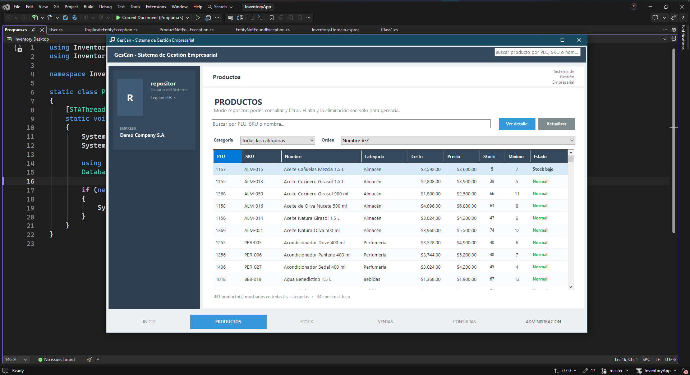
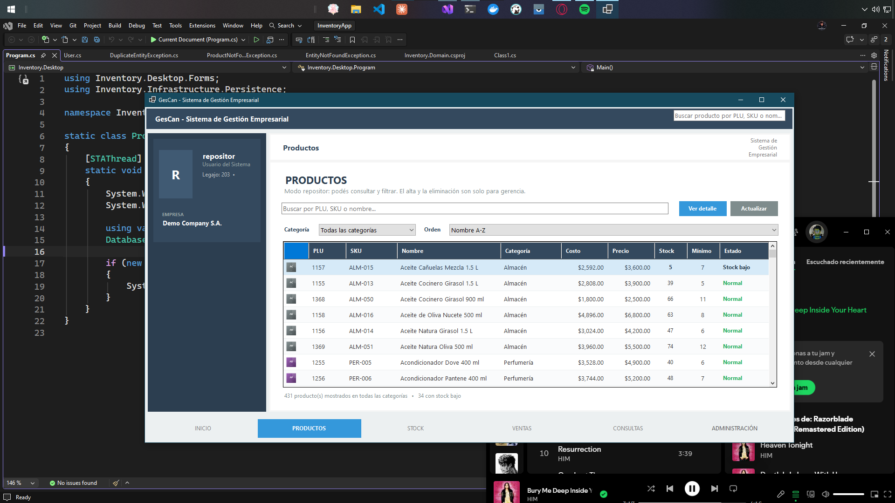
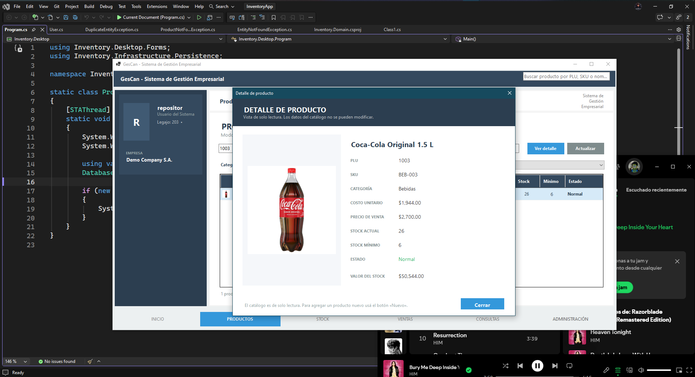
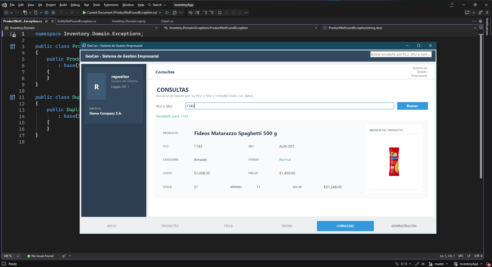
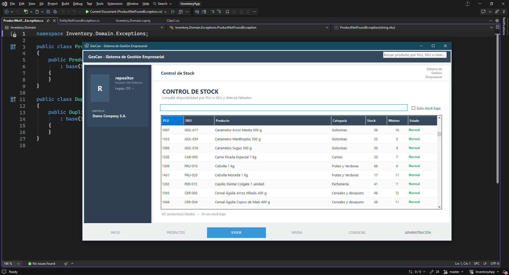

# GesCan — Sistema de Gestión de Inventario


Aplicación de escritorio para el control del flujo de inventario de un comercio: catálogo de productos, stock, consultas por PLU/SKU, imágenes y permisos por rol.

> **Proyecto educativo en desarrollo.** La app funciona y se puede probar, pero todavía tiene módulos incompletos y funcionalidades planeadas. Con el tiempo se irán mejorando la interfaz, la lógica de negocio y las pruebas.

---

## Capturas

| Inicio | Productos |
| :---: | :---: |
|  |  |

| Detalle de producto | Consultas |
| :---: | :---: |
|  |  |

| Stock |
| :---: |
|  |

---

## Funcionalidades

- **Login y sesión** con contraseñas hasheadas mediante BCrypt.
- **Panel de inicio** con productos activos, unidades totales, productos con stock bajo y valor del inventario.
- **Catálogo de productos** con 431 productos demo de supermercado en 11 categorías.
- **Buscador** por PLU, SKU, nombre o categoría.
- **Filtros** por categoría y orden por nombre (A-Z / Z-A) o stock (mayor / menor).
- **Miniaturas de productos** en la grilla del catálogo.
- **Vista de stock** con búsqueda y filtro de stock bajo.
- **Consultas por PLU o SKU** con ficha completa e imagen del producto.
- **Detalle de producto de solo lectura** con costo, precio, stock, mínimo, estado y valor del stock.
- **Imágenes de producto** cargadas desde el alta o de forma masiva por PLU/SKU.
- **Permisos por rol**: solo administración, gerencia y jefatura de salón pueden crear o eliminar productos.
- **Base SQLite** creada y poblada automáticamente con datos demo.

---

## Usuarios demo

Todos usan la contraseña `123456`.

| Usuario | Rol | Puede crear/eliminar productos |
| --- | --- | :---: |
| `admin` | Administrador | Sí |
| `gerente` | Gerente | Sí |
| `jefe` | Jefe de Salón | Sí |
| `repositor` | Repositor | No |
| `ecano` | Empleado | No |

Los usuarios sin permisos pueden consultar, buscar, filtrar y ver el detalle de los productos.

---

## Tecnologías

- **C# / .NET 10**
- **Windows Forms**
- **SQLite** + **Entity Framework Core 10**
- **BCrypt.Net-Next**
- **Clean Architecture + DDD**
- **GDI+ / WPF (WIC)** para el manejo de imágenes, incluyendo WebP

---

## Arquitectura

```
src/
├── Inventory.Domain/          # Entidades, value objects, reglas de negocio
├── Inventory.Application/     # Casos de uso, DTOs e interfaces
├── Inventory.Infrastructure/  # EF Core, SQLite y BCrypt
└── Inventory.Desktop/         # UI Windows Forms, vistas, formularios y seed demo

assets/                        # Capturas para el README
docs/                          # Documentación de funcionalidades futuras
```

Dependencias entre capas:

```
Desktop → Application → Domain
   └────→ Infrastructure ──┘
```

El dominio no depende de ninguna otra capa. La infraestructura implementa las interfaces definidas en Application.

---

## Cómo ejecutar

### Requisitos

- Windows 10/11
- [.NET 10 SDK](https://dotnet.microsoft.com/download)

### Pasos

```bash
git clone https://github.com/canoezequiel7k-sys/Inventory.git
cd Inventory
dotnet restore
dotnet run --project src/Inventory.Desktop
```

También podés compilar y ejecutar el binario:

```bash
dotnet build Inventory.slnx
src\Inventory.Desktop\bin\Debug\net10.0-windows\Inventory.Desktop.exe
```

La base `inventory.db` se crea automáticamente en la carpeta de ejecución del `.exe`. Si detecta un esquema viejo, la recrea con los datos demo.

---

## Imágenes de productos

Las imágenes se pueden cargar desde el formulario de alta o agregar de forma masiva:

```
src/Inventory.Desktop/images/products/
```

Nombrar el archivo con el **PLU** o el **SKU** del producto:

```
1003.png       ← Coca-Cola Original 1.5 L
BEB-003.png    ← el mismo producto por SKU
ALM-001.jpg    ← Fideos Matarazzo Spaghetti 500 g
```

Formatos admitidos: `.png`, `.jpg`, `.jpeg`, `.bmp`, `.gif` y WebP. Si no hay imagen, se genera un placeholder con las iniciales y el color de la categoría.

---

## Estado y próximos pasos

Módulos actuales:

- ✅ Inicio
- ✅ Productos
- ✅ Stock
- ✅ Consultas
- 🚧 Administración → reconteo físico mensual de stock
- 🚧 Ventas → pantalla placeholder

Próximas mejoras planeadas:

- Reconteo de stock por sección, separando **depósito** y **salón**.
- Lectura de productos por **código EAN**.
- Ajustes de stock mediante movimientos auditables.
- Edición de productos y reportes.
- Módulo de ventas.
- Pruebas automatizadas.

La especificación del reconteo de stock está en [`docs/reconteo-stock.md`](docs/reconteo-stock.md).

---

## Notas

- Este repositorio es un proyecto **educativo** y de práctica.
- Los productos, precios y usuarios son datos de demostración.
- Las credenciales demo no deben usarse en un entorno real.
- La aplicación está pensada para ejecutarse en Windows.
